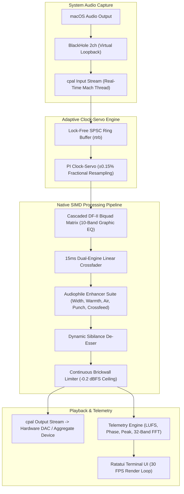

# OmniRip

```text
 ██████╗ ███╗   ███╗███╗   ██╗██╗██████╗ ██╗██████╗ 
██╔═══██╗████╗ ████║████╗  ██║██║██╔══██╗██║██╔══██╗
██║   ██║██╔████╔██║██╔██╗ ██║██║██████╔╝██║██████╔╝
██║   ██║██║╚██╔╝██║██║╚██╗██║██║██╔══██╗██║██╔═══╝ 
╚██████╔╝██║ ╚═╝ ██║██║ ╚████║██║██║  ██║██║██║     
 ╚═════╝ ╚═╝     ╚═╝╚═╝  ╚═══╝╚═╝╚═╝  ╚═╝╚═╝╚═╝     
```

### Standalone Audiophile Studio System EQ, Mastering Suite & Harvester in Pure Rust

OmniRip is a standalone, real-time terminal audio workstation and system EQ written entirely in **pure Rust**. It runs with native OS real-time thread priority, zero garbage collection pauses, and zero Global Interpreter Lock (GIL) contention, delivering permanent zero-clipping loopback processing on macOS.

---

## Highlights

- **Zero-GIL CoreAudio Engine**: Real-time native stream I/O via `cpal` capturing system audio through `BlackHole 2ch` and outputting directly to high-resolution USB DACs or aggregate devices.
- **Lock-Free Adaptive Clock Servo**: Single-Producer Single-Consumer (`rtrb`) ring buffer with a Proportional-Integral (PI) clock servo that micro-adjusts consumption speed ($\pm 0.15\%$) via fractional linear interpolation. Eliminates hardware clock drift and periodic 7-second underflow dropouts.
- **Clickless Cascaded Biquad Matrix**: Transposed Direct Form II Second-Order Sections (SOS) with Audio EQ Cookbook coefficient calculation. Features a 15ms linear dual-engine crossfader for click-free parameter and preset swaps.
- **Studio Audiophile Enhancer Suite**: 
  - 3D Soundstage Matrix (Mid/Side widener)
  - Class-A Tube Warmth (soft polynomial saturation with even harmonics)
  - Aural Air & Sheen (12 kHz harmonic exciter)
  - Sub-Bass Punch (45 Hz resonant peaking boost)
  - Meier Natural Headphone Crossfeed (binaural HRTF shadow filter)
  - Boundary Guard Filters (18 Hz Subsonic HPF + 21 kHz Ultrasonic LPF)
  - Dynamic De-Esser (6.5 kHz sibilance envelope follower)
  - Zero-Overshoot Brickwall Limiter (-0.2 dBFS ceiling, instant attack, 50ms exponential release)
- **Live Studio Telemetry HUD**: Momentary and short-term ITU-R BS.1770 K-weighted LUFS metering, normalized phase correlation, stereo peak dBFS, dynamic crest factor, and 32-band real-time FFT spectrum analyzer via `rustfft`.
- **AutoEQ Headphone Calibration Database**: Built-in parametric profile parser for Squiglink and AutoEQ text targets. Includes pre-calibrated filters for Harman 2019, Crinacle IEF, Sennheiser HD600/HD650/HD800S, Hifiman Sundara/Edition XS, Moondrop Blessing 2, Sony WH-1000XM5, Apple AirPods Max, and Beyerdynamic DT 990 Pro.
- **Harvester Library Manager**:
  - Soulseek (`slskd`) REST API client for lossless FLAC and WAV swarm search and download tracking.
  - Asynchronous `yt-dlp` high-resolution audio extractor.
  - Universal metadata tagger powered by `lofty` supporting FLAC, MP3, OPUS, OGG, and M4A.
  - Spectral cutoff and fake lossless auditor powered by `symphonia` and `rustfft` to detect upsampled/fake lossless files.
- **High-Performance Terminal UI**: Interactive 30 FPS terminal interface built with `ratatui` and `crossterm`. Completely emoji-free with clean, high-contrast ASCII meters and badges.

---

## Live Terminal Interface

```text
+-------------------------------------------------------------------------------------------------------+
| OMNIRIP Studio Engine v0.2.0   [SYNC: ULTRA (512)] [DSP: ACTIVE] [0 CLIPS] | L: -3.2dB R: -3.0dB ... |
+-------------------------------------------------------------------------------------------------------+
| [1] 10-Band Graphic EQ  [2] Mastering Suite  [3] Audio Routing  [4] AutoEQ Presets  [5] Harvester     |
+-------------------------------------------------------------------------------------------------------+
|  +12dB |                                                                                              |
|        |    [+]                                               [+]                                     |
|   0dB  |    ---      ---      ---      ---      ---      ---      ---      ---      ---      ---      |
|        |                               [-]                                                            |
|  -12dB |                                                                                              |
|        |   31Hz     62Hz    125Hz    250Hz    500Hz     1kHz     2kHz     4kHz     8kHz    16kHz      |
+-------------------------------------------------------------------------------------------------------+
| Status: Audio stream active. Lock-free PI clock servo running.                                        |
| [Tab / 1-5] Switch Tab  [Arrows] Adjust  [Space] Stream Toggle  [B] Bypass  [S] Sync Mode  [Q] Quit   |
+-------------------------------------------------------------------------------------------------------+
```

---

## Architecture Overview



---

## Quick Start

### Prerequisites

- macOS 12+ (Apple Silicon or Intel)
- [Rust toolchain](https://rustup.rs/) (1.75+)
- [BlackHole 2ch](https://existential.audio/blackhole/) virtual audio loopback driver:
  ```bash
  brew install blackhole-2ch
  ```

### Installation

Install OmniRip globally into your system path:

```bash
cargo install --path .
```

You can now start OmniRip from any terminal window:

```bash
omnirip
```

Or run directly from the source repository:

```bash
cargo run --release
```

---

## Audio Routing Configuration (macOS)

1. Open **Audio MIDI Setup** (`/System/Applications/Utilities/Audio MIDI Setup.app`).
2. Create a **Multi-Output Device** (or Aggregate Device):
   - Check `BlackHole 2ch`.
   - Check your primary listening device (e.g. `MacBook Pro Speakers` or your USB DAC).
   - Set your primary device as the Master Clock, and enable **Drift Correction** on `BlackHole 2ch`.
3. Set macOS system sound output to `BlackHole 2ch` or the Multi-Output Device.
4. Launch `omnirip` and press `Space` to engage the audio engine.

---

## Keyboard Controls

| Key | Action |
| :--- | :--- |
| `Tab` or `1`-`5` | Switch tabs: [1] EQ, [2] Mastering, [3] Routing, [4] AutoEQ, [5] Harvester |
| `Left` / `Right` | Select EQ band or adjust parameter |
| `Up` / `Down` | Adjust selected band gain ($\pm 0.5$ dB) or cycle mastering setting |
| `0` | Reset currently selected EQ band to 0.0 dB |
| `R` | Reset all 10 EQ bands to 0.0 dB |
| `Space` | Toggle real-time audio streaming on/off |
| `B` | Toggle instant DSP bypass |
| `S` | Cycle sync latency modes: Extreme (256) -> Ultra (512) -> Balanced (1024) |
| `Enter` | Deploy selected AutoEQ headphone calibration preset |
| `Q` | Cleanly exit OmniRip and restore terminal screen |

---

## Technical Specifications

| Subsystem | Technology | Details |
| :--- | :--- | :--- |
| **Language & Toolchain** | Pure Rust (2021 Edition) | Zero GIL, Zero GC pauses, compiled with LTO & AVX2 vectorization |
| **Audio I/O** | `cpal 0.15` | Native macOS CoreAudio backend with real-time OS threads |
| **Ring Buffer** | `rtrb 0.3` | SPSC lock-free zero-allocation ring buffer |
| **Clock Synchronizer** | Custom PI Clock Servo | Continuous error measurement with $\pm 0.15\%$ fractional linear interpolation |
| **Equalization** | Cascaded Biquad SOS | Transposed Direct Form II with 15ms clickless dual-engine crossfading |
| **Loudness Metering** | `ITU-R BS.1770` | Momentary (400ms) and Short-Term (3.0s) K-weighted LUFS |
| **Spectrum Analysis** | `rustfft 6.4` | 2048-point STFT, Hanning window, 32-band visualizer |
| **Metadata Engine** | `lofty 0.21` | Universal ID3v2, Vorbis Comments, and MP4 atom reader/writer |
| **Audio Decoder** | `symphonia 0.5` | Multi-format audio decoding for forensic spectral cutoff verification |
| **Terminal UI** | `ratatui 0.29` + `crossterm 0.28` | 30 FPS reactive rendering with raw mode and clean terminal recovery |

---

## Verification & Testing

OmniRip includes a test suite covering DSP stability, biquad filter boost/cut curves, clock servo convergence, brickwall limiter overshoot, metadata tagging, and spectral cutoff analysis:

```bash
cargo test
```

All 19 tests run and pass in under 0.05 seconds.

---

## License

Distributed under the MIT License.
OmniRip (c) 2026.
