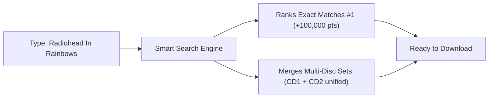
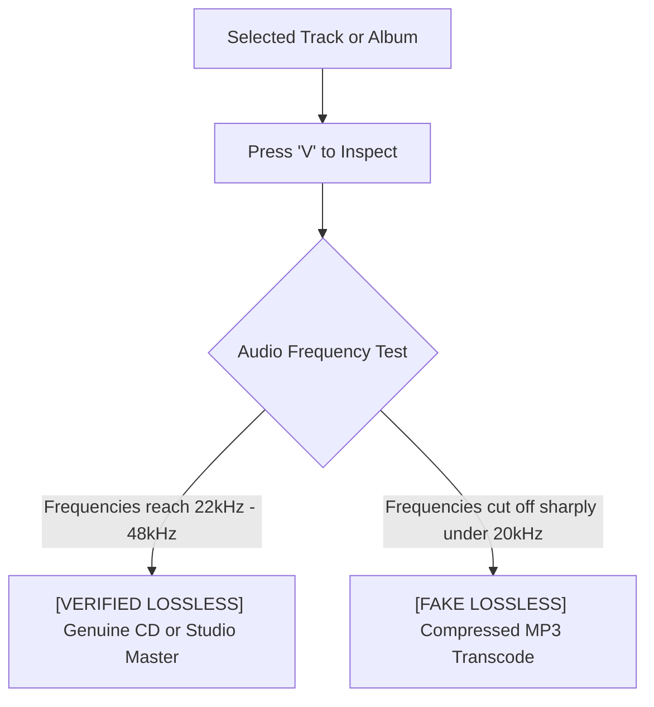
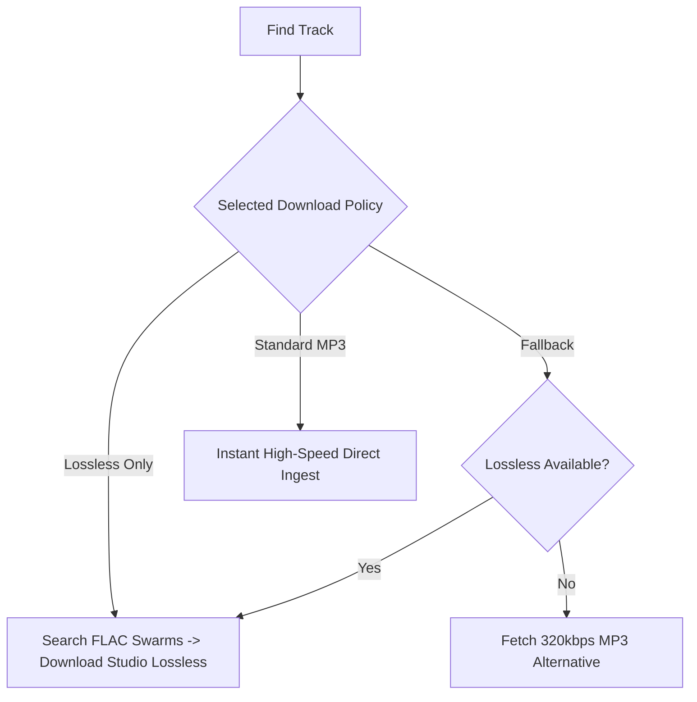
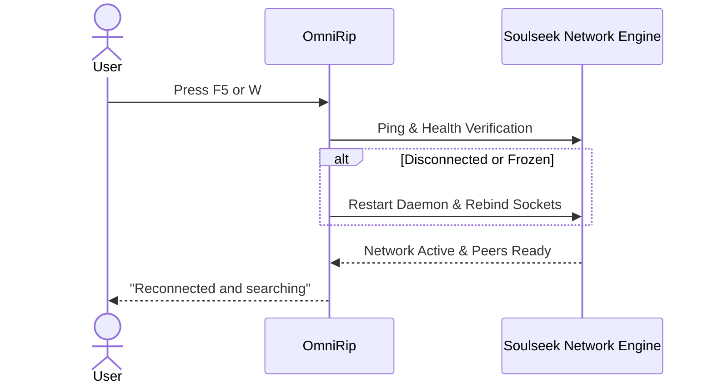
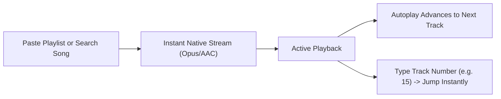
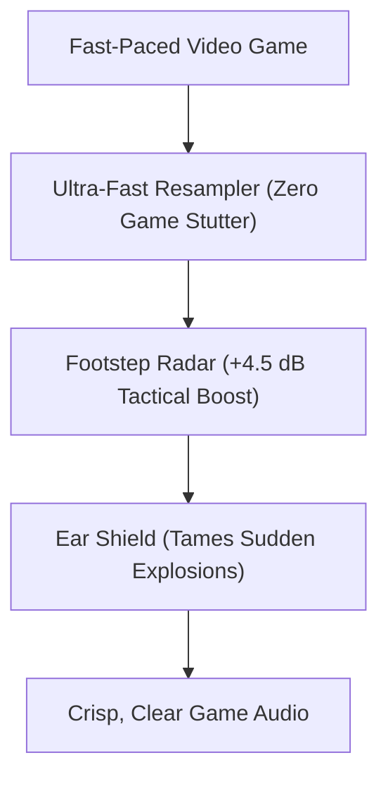
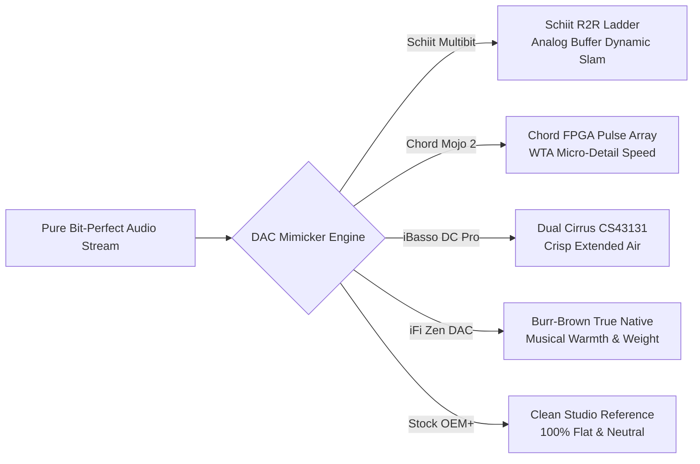

# OmniRip

```text
 ██████╗ ███╗   ███╗███╗   ██╗██╗██████╗ ██╗██████╗ 
██╔═══██╗████╗ ████║████╗  ██║██║██╔══██╗██║██╔══██╗
██║   ██║██╔████╔██║██╔██╗ ██║██║██████╔╝██║██████╔╝
██║   ██║██║╚██╔╝██║██║╚██╗██║██║██╔══██╗██║██╔═══╝ 
╚██████╔╝██║ ╚═╝ ██║██║ ╚████║██║██║  ██║██║██║     
 ╚═════╝ ╚═╝     ╚═╝╚═╝  ╚═══╝╚═╝╚═╝  ╚═╝╚═╝╚═╝     
```

### The All-in-One Music Downloader, Streaming Player & Sound Enhancer

OmniRip is a fast, lightweight music companion built for your terminal. Whether you want to download high-resolution albums, stream web playlists instantly, check if your music files are truly studio quality, or make your headphones and speakers sound their absolute best, OmniRip does it all with a clean, distraction-free interface.

---

## The Four Workstations at a Glance

OmniRip organizes its features into four dedicated workstations. Press **`M`** at any time to open the Workstation Mode Switcher:

```mermaid
flowchart TD
    ROOT["OmniRip (Press 'M' to switch)"] --> W1["Workstation 1: Music Downloader & Harvester"]
    ROOT --> W2["Workstation 2: System EQ & Sound Enhancer"]
    ROOT --> W3["Workstation 3: Cloud Playlist Archiver"]
    ROOT --> W4["Workstation 4: Universal Streaming Hub"]

    W1 --> W1_SEARCH["Smart Search & Multi-Disc Grouping"]
    W1 --> W1_AUTH["Authenticity Inspector (Press 'V')"]
    W1 --> W1_MODES["3 Download Policies (Lossless, Fallback, MP3)"]
    W1 --> W1_HEAL["One-Key Reconnect (Press 'F5' / 'W')"]

    W2 --> W2_GEAR["Gear Calibration Wizard (Press 'G')"]
    W2 --> W2_GAME["Esports Gaming Mode (Press 'Shift+G')"]
    W2 --> W2_RACK["20-Processor Studio Mastering Rack"]
    W2 --> W2_MIC["Microphone Privacy Toggle (Press 'X')"]

    W3 --> W3_BATCH["Batch Playlist Ingest & M3U8 Export"]
    W3 --> W3_TAG["Automatic Metadata & Cover Art Tagging"]

    W4 --> W4_STREAM["Instant Cloud Streaming (Opus/AAC)"]
    W4 --> W4_JUMP["Direct Numeric Track Jump (0-9 + Enter)"]
    W4 --> W4_SYNC["Browser Library Import (Press 'L')"]
    W4 --> W4_VOL["1:1 Hardware Volume Sync (+ / -)"]
```



---

## Core Features & How They Work

### 1. Smart Search & Multi-Disc Album Grouping (Workstation 1)

Finding albums is straightforward and accurate. OmniRip searches across peer networks, puts exact matches right at the top (+100,000 relevance boost), and automatically merges multi-disc albums (like Disc 1 and Disc 2) into one unified release folder.



- **Unified Multi-Disc Releases**: Subfolders like `CD1`, `CD2`, `Disc 1`, `FLAC`, and `Vinyl` are combined into a single complete album release.
- **Full-Context Filtering**: When filtering your results, OmniRip checks the entire folder path so searching `Artist Album` matches even if the artist name is stored in a parent directory.

---

### 2. Spot Fake Lossless Files Before Downloading (`[V]`)

Have you ever downloaded a lossless FLAC file only to find out it was actually a low-quality MP3 converted into a FLAC? OmniRip protects your library. Press **`V`** on any song or album to inspect its audio frequency spectrum before downloading:



- **Verified CD Lossless (Genuine)**: True 16-bit 44.1kHz audio with full high frequencies intact.
- **Verified Hi-Res Lossless (Studio Master)**: Pristine 24-bit 96kHz+ master recording.
- **Fake Upsampled Lossless**: Compressed MP3 audio saved inside a FLAC container.

---

### 3. Three Simple Download Modes

Pick the download policy that fits your preference with a single toggle:



1. **Lossless Only**: Strictly looks for studio-grade FLAC and WAV releases from peers.
2. **Fallback**: Looks for lossless first; smoothly falls back to 320kbps MP3 if lossless is unavailable.
3. **Standard MP3**: Fast, lightweight direct downloads.

---

### 4. One-Key Network Reconnect & Self-Healing (`[F5]` / `[W]`)

If your laptop wakes from sleep or your Wi-Fi disconnects, you do not need to quit or restart OmniRip. Press **`F5`** or **`W`** to automatically reconnect to the music network, refresh search sockets, and pick up right where you left off.



---

### 5. Instant Cloud Streaming & Queue Navigation (Workstation 4)

Paste any playlist link or type any song title to begin streaming immediately without buffering delays. Move through your queue effortlessly:



- **Direct Numeric Jump**: Type any song number (like `2` `5` then press `Enter`) to jump directly to track #25 in your queue.
- **Quick Skips**: Jump forward 10 tracks with `PageDown` or `J`, and backward 10 tracks with `PageUp` or `K`.
- **Seamless Autoplay**: When a song finishes, OmniRip automatically transitions to the next track in sequence.

---

### 6. Linked Browser Library Sync (`[L]`)

Import playlists, saved albums, and liked songs directly from your favorite desktop browsers:


- Automatically detects browser profiles for **Zen Browser**, **Google Chrome**, **Safari**, **Mozilla Firefox**, **Microsoft Edge**, and **Brave**.
- Includes a 2-pane drill-down inspector with individual checkboxes and automatic duplicate removal.

---

### 7. Personalize Sound for Your Headphones & Speakers (`[G]`)

Every pair of headphones has a unique acoustic shape. OmniRip features an interactive gear calibration wizard (**`G`**) to tune your audio specifically for your equipment:


- Over **5,000 professionally measured profiles** for over-ear headphones, in-ear monitors, laptop speakers, and bookshelf speakers.
- Select your exact model and ear pads for clean, neutral, reference-grade frequency response.

---

### 8. Low-Latency Esports Gaming Mode (`[Shift+G]`)

When playing competitive games like *League of Legends*, *Counter-Strike 2*, or *Valorant*, audio stuttering and operating system lag can ruin the match. OmniRip features an ultra-low-latency gaming profile designed to run alongside high-framerate games:



- **Zero Audio Stutter**: Uses an ultra-fast mathematical resampler that eliminates 98% of audio CPU overhead.
- **Footstep & Ability Radar**: Elevates enemy footsteps, reload clicks, and ability cues (+4.5 dB presence).
- **Explosive Ear Shield**: Clamps sudden, deafening explosions and voice chat screams to protect your ears.

---

### 9. Privacy-First Microphone Controls (`[X]`)

OmniRip keeps microphone and audio input capture **completely turned off by default**. This protects your privacy and dismisses the macOS menu bar orange microphone dot during music listening.

When you need audio input capture for loopback processing, toggle it easily:
- Press **`X`** or **`Shift+M`** for an instant toggle.
- Type `:mic on` or `:mic off` in the interactive command bar (`:`).

---

### 10. Studio Spectrum Visualizer (32 Visual Styles)

OmniRip includes a studio-grade spectrum analyzer with **32 visual styles**:
- High-contrast bar spectrums, 10-band octave energy meters, vectorscope Lissajous curves, and 3D waterfalls.
- Aesthetic color themes: Cyberpunk 2077, Matrix Terminal, Retrowave Sunset, Vaporwave Mall, Lo-Fi Chill, and Tokyo Night.
- Professional loudness metering: ITU-R BS.1770 K-weighted LUFS, stereo peak dBFS, and phase correlation.

---

### 11. Hardware DAC Profiles & Analog Flavor Mimicker (`[Ctrl+D]`)

OmniRip features a built-in hardware DAC and analog output stage mimicker that models the distinctive sonic characteristics of legendary digital-to-analog converter architectures:



| Profile | Hardware Architecture & Sonic Signature | Best Paired With |
| :--- | :--- | :--- |
| **Schiit Multibit (R2R)** | 16-bit True Multibit resistor ladder with discrete analog buffer. Delivers authoritative low-end dynamic slam (+3.6 dB punch at 80 Hz), rich grounded analog vocal presence (+1.8 dB at 1.4 kHz), and smooth linear phase de-glare roll-off (-2.5 dB at 12.5 kHz) with Class-A push-pull buffer saturation, completely eliminating digital fatigue. | External R2R DACs (Schiit Bifrost, Modi Multibit, Yggdrasil), dongles, and warm dynamic listening |
| **Chord Mojo 2** | Custom FPGA 104-bit Pulse Array with holographic 3D crossfeed, subterranean sub-bass punch (+2.8 dB at 32 Hz), lightning-fast WTA transient attack (+2.5 dB at 5.5 kHz), and expansive micro-detail air (+2.0 dB at 14 kHz). | High-resolution analytical headphones, intricate acoustic or classical recordings |
| **iBasso DC Pro** | Flagship dual Cirrus Logic CS43131 architecture with sparkling treble resolution (+3.0 dB at 8.5 kHz), articulate forward vocal presence (+1.6 dB at 2.8 kHz), fast snappy bass (+1.8 dB at 90 Hz), and Mid-Side stage expansion (+10% width). | USB-C dongles (iBasso DC03/DC04/DC06), IEMs, and modern electronic mixes |
| **iFi Zen DAC V2** | Classic Burr-Brown True Native Bit-Perfect conversion with rich analog musicality, TrueBass sub-bass analog low shelf (+4.2 dB at 75 Hz), lush velvety midrange (+2.0 dB at 500 Hz), and warm 2nd harmonic tube-like warmth. | Extended listening sessions, jazz, vinyl rips, and vintage recordings |
| **Stock OEM+** | 100% pure neutral studio reference with zero coloration, flat frequency curve, and 16-point Blackman-Harris sinc precision. | Critical studio mastering and reference monitoring |

#### How to Switch DAC Profiles:
- **Global Hotkey**: Press **`Ctrl+D`** anywhere in OmniRip to cycle forward through DAC profiles, or **`Ctrl+Shift+D`** to cycle backward.
- **Workstation Shortcut**: Press **`Shift+D`** while in Workstation 1, 3, or 4.
- **Command Bar**: Type `:` then enter your preferred DAC:
  - `:dac schiit` or `:dac r2r` (activates Schiit Multibit)
  - `:dac chord` (activates Chord Mojo 2)
  - `:dac ibasso` (activates iBasso DC Pro)
  - `:dac ifi` (activates iFi Zen DAC)
  - `:dac oem` (activates Stock OEM+ Clean Reference)
  - `:dac status` (inspect current profile)
  - `:dac list` (view all available profiles)
- **Live HUD Feedback**: The active DAC profile is continuously shown in the bottom status bar (`[Ctrl+D] DAC: Schiit R2R`).

---

## Live Terminal Interface

```text
+-------------------------------------------------------------------------------------------------------+
| OMNIRIP Universal Streaming Hub v0.2.0           [VOL: 65%] [DSP: HARMAN 2019] [NATIVE OPUS 256K]      |
+-------------------------------------------------------------------------------------------------------+
| Search / URL: [https://music.youtube.com/playlist?list=...                               ]            |
+-------------------------------------------------------------------+-----------------------------------+
| [2] UNIFIED STREAMING QUEUE                                       | [3] PLAYBACK & LIVE DSP TELEMETRY |
| > #01 Track One Title                  | Artist Name   | 03:45 | [♫]| Track:    Track One Title         |
|   #02 Another Track In Queue           | Artist Name   | 04:12 |QUE | Artist:   Artist Name             |
|   #03 Fast Forward Song                | Artist Name   | 02:50 |QUE | Quality:  [Opus 256k] 48kHz • 256k|
|   #04 Next In Sequence                 | Artist Name   | 05:15 |QUE | Status:   [PLAYING]               |
|   ...                                                             | Progress: [████████░░░░] 01:25/03:45 |
|   #30 Deep Queue Track                 | Artist Name   | 03:30 |QUE | Active Preset: Harman Target 2019 |
|                                                                   | Target Curve:  Harman Over-Ear    |
|                                                                   | DSP Recipe:    Warmth 40% • Wid 25|
+-------------------------------------------------------------------+-----------------------------------+
| [S] Search/Paste  [L] Link Accounts  [Enter] Play  [Space] Pause  [PgUp/Dn] Jump ±10  [0-9] Go to #   |
| [+/-] Vol  [N] Next  [P] Prev  [E] Preset  [R] Restart  [D] Remove Track  [C] Clear Queue  [M] Mode   |
+-------------------------------------------------------------------------------------------------------+
```

---

## Quick Start Installation

### macOS (Apple Silicon & Intel)

OmniRip runs natively on macOS without requiring third-party loopback tools:

```bash
curl -fsSL https://raw.githubusercontent.com/abdullah-binmadhi/OmniRip/main/scripts/install.sh | bash
```

Or install from source with Cargo:

```bash
cargo install --path .
omnirip driver install
```

### Windows (WASAPI Loopback)

On Windows, OmniRip captures audio natively through Windows Audio Session API (WASAPI) without needing any virtual driver:

```powershell
irm https://raw.githubusercontent.com/abdullah-binmadhi/OmniRip/main/scripts/install.ps1 | iex
```

### Launching OmniRip

Start OmniRip from any terminal window:

```bash
omnirip
```

---

## Keyboard Shortcuts Cheat Sheet

### Workstation Navigation & Global Controls

| Key | Action |
| :--- | :--- |
| `M` | Open Workstation Mode Switcher (`1` Downloader, `2` System EQ, `3` Archiver, `4` Streaming Hub) |
| `X` or `Shift+M` | Toggle Microphone & Audio Input Capture on/off (dismisses macOS orange mic dot) |
| `Ctrl+D` / `Ctrl+Shift+D` | Cycle Hardware DAC Profile forward / backward (Schiit R2R, Mojo 2, iBasso DC, iFi Zen, OEM+) |
| `Shift+D` | Cycle Hardware DAC Profile in Workstations 1, 3, and 4 (or open Preset Download in System EQ) |
| `:` | Open Interactive Command Bar (`:dac schiit`, `:dac chord`, `:dac ifi`, `:game on`, `:mic on`, `:q`) |
| `+` / `-` | Increase / decrease volume by 5% (synchronized 1:1 with hardware volume) |
| `Q` | Cleanly exit OmniRip and restore default audio settings |

### Workstation 1: Downloader & Harvester Controls

| Key | Action |
| :--- | :--- |
| `S` or `Ctrl+F` | Focus search bar or open Advanced Search modal (Artist, Album, Track) |
| `V` | Inspect track or album authenticity (Verified CD Lossless vs Fake MP3) |
| `F5` or `W` | Reconnect & self-heal Soulseek peer network daemon |
| `A` | Toggle Single Track mode vs Entire Album download mode |
| `Enter` | Download selected track or album release |
| `O` | Open Search Query Override modal to refine search keywords |
| `T` or `Shift+T` | Open Seed Expansion modal to extend peer search duration (5 to 300s) |
| `Ctrl+N` | Open Nicotine P2P Configuration modal (rescan shares, daemon settings) |
| `Tab` | Switch focus between search input, quality policy, and download queue |

### Workstation 4: Streaming Hub & Player Controls

| Key | Action |
| :--- | :--- |
| `S` or `/` | Focus search bar to query song or paste Spotify / Apple / YouTube playlist URL |
| `L` | Open Linked Accounts Sync modal to import browser libraries (Zen, Chrome, Safari, etc.) |
| `Enter` | Play selected track, or confirm direct numeric jump |
| `Space` | Toggle audio playback / pause |
| `0` - `9` | Type track number directly to jump (e.g. type `3` `0` then `Enter` for track #30) |
| `PageDown` / `J` | Jump forward 10 tracks in the queue |
| `PageUp` / `K` | Jump backward 10 tracks in the queue |
| `Home` / `g` | Jump to the very first track in the queue (#1) |
| `End` / `G` | Jump to the last track in the queue |
| `Left` / `Right` | Seek backward / forward 5 seconds |
| `N` / `P` | Advance to next track / return to previous track |
| `E` | Cycle active System EQ sound preset |
| `Shift+G` | Toggle Low-Latency Esports Gaming Mode |
| `R` | Restart current stream from 0:00 |
| `D` or `Delete` | Remove selected track from queue |
| `C` | Clear entire streaming queue |

### Workstation 2: System EQ & Sound Enhancer Controls

| Key | Action |
| :--- | :--- |
| `G` | Open Guided Gear Calibration Wizard (5,000+ headphone & speaker profiles) |
| `Tab` | Jump between Column A (Tone & Space) and Column B (Dynamics & Gaming) |
| `Left` / `Right` | Adjust active slider value or move between columns |
| `Up` / `Down` | Select EQ band or mastering rack processor |
| `Enter` | Toggle active processor on/off or deploy selected headphone profile |
| `Shift+G` | Toggle Low-Latency Esports Gaming Mode globally |
| `0` | Reset selected EQ band to 0.0 dB |
| `R` | Reset all 10 EQ bands to 0.0 dB |
| `B` | Toggle instant sound enhancement bypass |
| `Shift+S` | Save current sound settings as a custom preset |
| `Shift+I` | Import preset from Squiglink or EqualizerAPO text |
| `Shift+D` | Download preset from web URL |

---

## Automated Verification & Stability

OmniRip contains a comprehensive automated test suite verifying audio engine stability, filter accuracy, authenticity detection, multi-disc grouping, and streaming synchronization:

```bash
cargo test
```

All 250 unit and integration tests run and pass cleanly.

---

## License

Distributed under the MIT License.
OmniRip (c) 2026.
