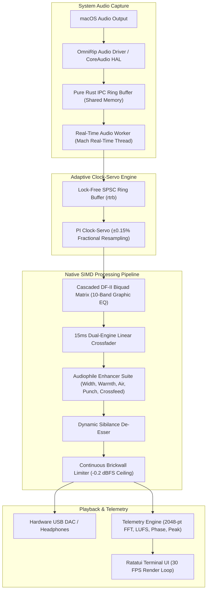

# OmniRip

```text
 ██████╗ ███╗   ███╗███╗   ██╗██╗██████╗ ██╗██████╗ 
██╔═══██╗████╗ ████║████╗  ██║██║██╔══██╗██║██╔══██╗
██║   ██║██╔████╔██║██╔██╗ ██║██║██████╔╝██║██████╔╝
██║   ██║██║╚██╔╝██║██║╚██╗██║██║██╔══██╗██║██╔═══╝ 
╚██████╔╝██║ ╚═╝ ██║██║ ╚████║██║██║  ██║██║██║     
 ╚═════╝ ╚═╝     ╚═╝╚═╝  ╚═══╝╚═╝╚═╝  ╚═╝╚═╝╚═╝     
```

### Standalone Audiophile Studio System EQ, Mastering Suite & Harvester in Pure Rust

OmniRip is a standalone, real-time terminal audio workstation and system EQ written entirely in **pure Rust**. It runs with native OS real-time thread priority, zero garbage collection pauses, and zero Global Interpreter Lock (GIL) contention, delivering permanent zero-clipping loopback processing on macOS.

---

## Highlights

- **Built-in CoreAudio Virtual Driver & IPC Engine**: Custom OmniRip Audio HAL driver coupled with a high-speed, zero-latency pure Rust userland IPC transport. Eliminates the need for third-party loopback software or complex manual Multi-Output Device configurations.
- **Lock-Free Adaptive Clock Servo**: Single-Producer Single-Consumer (`rtrb`) ring buffer with a Proportional-Integral (PI) clock servo that micro-adjusts consumption speed ($\pm 0.15\%$) via fractional linear interpolation. Eliminates hardware clock drift and periodic buffer underflow dropouts.
- **Clickless Cascaded Biquad Matrix**: Transposed Direct Form II Second-Order Sections (SOS) with Audio EQ Cookbook coefficient calculation. Features a 15ms linear dual-engine crossfader for click-free parameter and preset swaps.
- **Studio Audiophile Enhancer Suite**: 
  - 3D Soundstage Matrix (Mid/Side widener)
  - Class-A Tube Warmth (soft polynomial saturation with even harmonics)
  - Aural Air & Sheen (12 kHz harmonic exciter)
  - Sub-Bass Punch (45 Hz resonant peaking boost)
  - Meier Natural Headphone Crossfeed (binaural HRTF shadow filter)
  - Boundary Guard Filters (18 Hz Subsonic HPF + 21 kHz Ultrasonic LPF)
  - Dynamic De-Esser (6.5 kHz sibilance envelope follower)
  - Zero-Overshoot Brickwall Limiter (-0.2 dBFS ceiling, instant attack, 50ms exponential release)
- **Studio-Grade Spectrum Visualizer & Telemetry HUD**:
  - 2048-point Radix-2 FFT with ISO 266 1/3-octave logarithmic filter bank spanning 20 Hz to 20 kHz.
  - Studio acoustic pink noise tilt (+3.0 dB/octave) for balanced high-frequency resolution.
  - ANSI S1.11 10-band Octave Energy Meter.
  - Dynamically distributed full-width X-axis frequency markers (`20`, `31`, `63`, `125`, `250`, `500`, `1k`, `2k`, `4k`, `8k`, `16k`, `20k`).
  - Momentary and short-term ITU-R BS.1770 K-weighted LUFS metering, normalized phase correlation, stereo peak dBFS, and dynamic crest factor.
- **Preset Management & Headphone Calibration Suite**:
  - Preset Persistence (`Shift+S`): Save active 10-band EQ, DSP enhancer, and limiter settings to local storage (`~/.config/omnirip/presets.json`).
  - Squiglink & EqualizerAPO Text Importer (`Shift+I`): Paste parametric EQ filter strings directly from the clipboard.
  - Safe Preset Downloader (`Shift+D`): Retrieve EQ profiles from verified HTTP/HTTPS endpoints with domain safety checks.
  - Built-in profile library: Harman 2019, Crinacle IEF, Sennheiser HD600/HD650/HD800S, Hifiman Sundara/Edition XS, Moondrop Blessing 2, Sony WH-1000XM5, Apple AirPods Max, Beyerdynamic DT 990 Pro.
- **Master Factory Reset & Route Healing (`Shift+R`)**:
  - Single-keystroke restoration of all DSP, EQ, enhancer parameters, and volume levels to clean reference state.
  - Verifies and repairs macOS CoreAudio system routing, flushes audio buffers, and restores unmuted playback without restarting the application.
- **Clean Play / Pause with Micro-Fade (`Space`)**:
  - Instantaneous stream mute/pause toggle with a 5 ms linear micro-fade. Retains CoreAudio device lock so external audio does not bypass DSP routing.
- **Harvester Library Manager**:
  - Soulseek (`slskd`) REST API client for lossless FLAC and WAV swarm search and download tracking.
  - Asynchronous `yt-dlp` high-resolution audio extractor.
  - Universal metadata tagger powered by `lofty` supporting FLAC, MP3, OPUS, OGG, and M4A.
  - Spectral cutoff and fake lossless auditor powered by `symphonia` and `rustfft` to detect upsampled/fake lossless files.
- **High-Performance Terminal UI**: Interactive 30 FPS terminal interface built with `ratatui` and `crossterm`. Completely emoji-free with clean, high-contrast ASCII meters and badges.

---

## Live Terminal Interface

```text
+-------------------------------------------------------------------------------------------------------+
| OMNIRIP Studio Engine v0.2.0   [SYNC: ULTRA (512)] [DSP: ACTIVE] [0 CLIPS] | L: -3.2dB R: -3.0dB ... |
+-------------------------------------------------------------------------------------------------------+
| [1] 10-Band Graphic EQ  [2] Mastering Suite  [3] Audio Routing  [4] AutoEQ Presets  [5] Harvester     |
+-------------------------------------------------------------------------------------------------------+
|  +12dB |                                                                                              |
|        |    [+]                                               [+]                                     |
|   0dB  |    ---      ---      ---      ---      ---      ---      ---      ---      ---      ---      |
|        |                               [-]                                                            |
|  -12dB |                                                                                              |
|        |   31Hz     62Hz    125Hz    250Hz    500Hz     1kHz     2kHz     4kHz     8kHz    16kHz      |
+-------------------------------------------------------------------------------------------------------+
| Status: Audio stream active. Lock-free PI clock servo running.                                        |
| [Tab / 1-5] Switch Tab  [Arrows] Adjust  [Space] Stream Toggle  [B] Bypass  [S] Sync Mode  [Q] Quit   |
+-------------------------------------------------------------------------------------------------------+
```

---

## Architecture Overview



---

## Quick Start

### macOS Installation

OmniRip runs on Apple Silicon and Intel Macs without requiring an Apple Developer Certificate:

- **Automated One-Line Install**:
  ```bash
  curl -fsSL https://raw.githubusercontent.com/abdullah-binmadhi/OmniRip/main/scripts/install.sh | bash
  ```

- **Or Install via Cargo**:
  ```bash
  cargo install --path .
  omnirip driver install
  ```

- **Manual Release Archive**:
  Download `omnirip-macos-arm64.tar.gz` from GitHub Releases. If macOS displays a verification prompt, clear the quarantine attribute:
  ```bash
  xattr -cr /path/to/omnirip
  ```

---

### Windows Installation

On Windows, OmniRip captures audio natively via WASAPI Loopback (`AUDCLNT_STREAMFLAGS_LOOPBACK`). No virtual audio driver or kernel extension is needed.

- **Automated PowerShell Install**:
  ```powershell
  irm https://raw.githubusercontent.com/abdullah-binmadhi/OmniRip/main/scripts/install.ps1 | iex
  ```

- **Or Install via Cargo**:
  ```powershell
  cargo install --path .
  ```

- **Standalone Executable**:
  Download `omnirip-windows-x64.zip` from GitHub Releases, extract `omnirip.exe`, and launch it from Windows Terminal or PowerShell.

---

### Launching OmniRip

Start OmniRip from any terminal window:

```bash
omnirip
```

Or run directly from the source repository:

```bash
cargo run --release
```

---

## Audio Routing Configuration (macOS)

OmniRip automatically manages audio routing:

1. **Automatic Routing (Recommended)**:
   - When the OmniRip Audio driver is installed, OmniRip sets macOS default output to `OmniRip Audio`.
   - Incoming audio is processed through the DSP pipeline and streamed directly to your active hardware output (USB DAC, headphones, or internal speakers).
   - Upon exit (`Q`), OmniRip restores your previous default audio output device.

2. **Route Healing**:
   - If audio output switches unexpectedly or external software changes system routing, press `Shift+R` to trigger Master Reset & Route Healing. OmniRip will re-verify the active CoreAudio device chain and restore clean DSP routing.

3. **Fallback Loopback (BlackHole 2ch)**:
   - If using BlackHole 2ch, select `BlackHole 2ch` as the input device in Tab `[3] Audio Routing` and route output to your DAC.

---

## Keyboard Controls

| Key | Action |
| :--- | :--- |
| `Tab` or `1`-`5` | Switch tabs: [1] EQ, [2] Mastering, [3] Routing, [4] AutoEQ, [5] Harvester |
| `Left` / `Right` | Select EQ band or adjust active parameter |
| `Up` / `Down` | Adjust selected band gain ($\pm 0.5$ dB) or cycle mastering setting |
| `0` | Reset currently selected EQ band to 0.0 dB |
| `R` | Reset all 10 EQ bands to 0.0 dB |
| `Shift+R` | Master Factory Reset (resets all DSP parameters and heals CoreAudio route) |
| `Space` | Toggle real-time audio playback / pause (5 ms micro-fade, retains route lock) |
| `Shift+S` | Save current EQ, DSP enhancers, and limiter settings as a custom preset |
| `Shift+I` | Import preset from raw Squiglink or EqualizerAPO text |
| `Shift+D` | Download preset from HTTP/HTTPS URL |
| `B` | Toggle instant DSP bypass |
| `S` | Cycle sync latency modes: Extreme (256) -> Ultra (512) -> Balanced (1024) |
| `Enter` | Deploy selected AutoEQ headphone calibration preset |
| `Q` | Cleanly exit OmniRip and restore default macOS audio output device |

---

## Technical Specifications

| Subsystem | Technology | Details |
| :--- | :--- | :--- |
| **Language & Toolchain** | Pure Rust (2021 Edition) | Zero GIL, zero GC pauses, compiled with LTO & AVX2 vectorization |
| **Audio Driver & IPC** | OmniRip Audio HAL + Userland IPC | Zero-latency shared memory transport with CoreAudio driver management |
| **Audio Playback I/O** | `cpal 0.15` | Native macOS CoreAudio backend with real-time Mach threads |
| **Ring Buffer** | `rtrb 0.3` | SPSC lock-free zero-allocation ring buffer |
| **Clock Synchronizer** | Custom PI Clock Servo | Continuous error measurement with $\pm 0.15\%$ fractional linear interpolation |
| **Equalization** | Cascaded Biquad SOS | Transposed Direct Form II with 15ms clickless dual-engine crossfader |
| **Loudness Metering** | `ITU-R BS.1770` | Momentary (400ms) and Short-Term (3.0s) K-weighted LUFS |
| **Spectrum Analysis** | `rustfft 6.4` | 2048-point STFT, ISO 266 1/3-octave log filter bank, +3dB/octave pink tilt |
| **Preset Storage** | JSON in `~/.config/omnirip/` | Atomic preset persistence, Squiglink text importer, safe URL downloader |
| **Metadata Engine** | `lofty 0.21` | Universal ID3v2, Vorbis Comments, and MP4 atom reader/writer |
| **Audio Decoder** | `symphonia 0.5` | Multi-format audio decoding for forensic spectral cutoff verification |
| **Terminal UI** | `ratatui 0.29` + `crossterm 0.28` | 30 FPS reactive rendering with raw mode and clean terminal recovery |

---

## Verification & Testing

OmniRip includes an automated test suite covering DSP stability, biquad filter boost/cut curves, clock servo convergence, brickwall limiter overshoot, preset persistence, URL validation, metadata tagging, and spectral cutoff analysis:

```bash
cargo test
```

All 66 tests run and pass in under 0.15 seconds.

---

## License

Distributed under the MIT License.
OmniRip (c) 2026.
