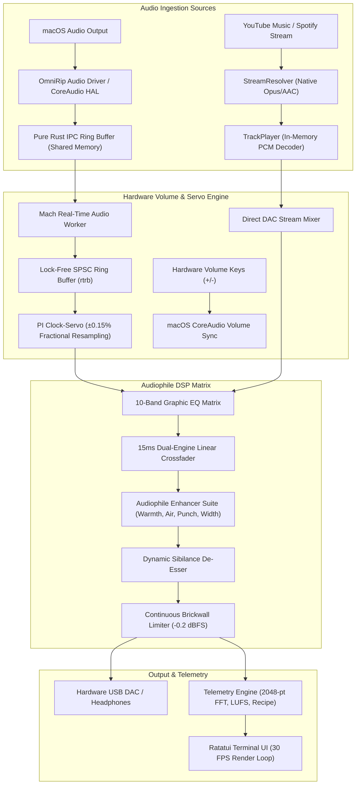

# OmniRip

```text
 ██████╗ ███╗   ███╗███╗   ██╗██╗██████╗ ██╗██████╗ 
██╔═══██╗████╗ ████║████╗  ██║██║██╔══██╗██║██╔══██╗
██║   ██║██╔████╔██║██╔██╗ ██║██║██████╔╝██║██████╔╝
██║   ██║██║╚██╔╝██║██║╚██╗██║██║██╔══██╗██║██╔═══╝ 
╚██████╔╝██║ ╚═╝ ██║██║ ╚████║██║██║  ██║██║██║     
 ╚═════╝ ╚═╝     ╚═╝╚═╝  ╚═══╝╚═╝╚═╝  ╚═╝╚═╝╚═╝     
```

### Standalone Audiophile Studio System EQ, Mastering Suite, Cloud Streaming Hub & Harvester in Pure Rust

OmniRip is a standalone, real-time terminal audio workstation and system EQ written entirely in **pure Rust**. It runs with native OS real-time thread priority, zero garbage collection pauses, and zero Global Interpreter Lock (GIL) contention, delivering permanent zero-clipping loopback processing and native cloud audio playback.

OmniRip combines four specialized workstations accessible via the Mode Switcher (`[M]`):
1. **Workstation 1: MP3 Downloader & Media Harvester** - Lossless Soulseek / FLAC swarming and high-res audio extraction.
2. **Workstation 2: System EQ & Audiophile Mastering Suite** - 10-band cascaded biquad matrix, tube warmth, soundstage enhancer, and 2048-point FFT.
3. **Workstation 3: Lossless Audio Archiver** - Batch ingest, local deduplication, M3U8 playlist creation, and metadata embedding.
4. **Workstation 4: Universal Streaming Hub & Live DSP Telemetry** - High-bitrate cloud streaming, linked browser library sync, hardware volume synchronization, and live telemetry.

---

## Highlights

- **Universal Streaming Hub (Workstation 4)**:
  - Instant cloud audio streaming from YouTube Music and Spotify playlist URLs.
  - Native format streaming (`bestaudio[acodec=opus]` / `webm` / `m4a`) bypassing transcode overhead for ~1-2s stream start latency.
  - Seamless autoplay advancing through queued tracks on playback completion.
  - Independent audio sample purging on track transitions to eliminate stale audio replays.
- **Hardware Device Volume Synchronization**:
  - Full 1:1 synchronization with macOS hardware volume keys (`+`, `-`, and system sound controls).
  - Queries active macOS system volume on boot and keeps hardware and application volume unified without digital double-attenuation.
  - Persistent volume safety engine (`~/.config/omnirip/volume.json`) preventing accidental volume spikes across launches.
- **Linked Account Sync & Multi-Browser Discovery (`[L]`)**:
  - Automatically identifies local browser profiles (Zen Browser, Google Chrome, Safari, Microsoft Edge, Brave, and Mozilla Firefox).
  - Imports playlists, albums, and liked collections directly into the streaming queue.
  - 2-pane drill-down track inspector with individual track checkboxes and automatic duplicate filtering.
- **Multi-Song Queue Navigation & Direct Numeric Track Jump**:
  - Single-step navigation with `Up` / `Down` or `k` / `j`.
  - Multi-song jumps: `PageDown` / `J` (+10 tracks), `PageUp` / `K` (-10 tracks).
  - Queue boundaries: `Home` / `g` (track #1) and `End` / `G` (last track).
  - Direct Numeric Jump: Type any track number directly on your keyboard (e.g. `3` `0`) and press `Enter` to jump straight to that track and stream immediately.
- **Live DSP Telemetry HUD**:
  - Real-time display of the active System EQ preset, Harman target curve, calibrated gear model, filter count, and DSP recipe settings inside the playback panel.
  - Press `E` to cycle system EQ presets directly from the streaming hub with immediate telemetry refresh.
- **Built-in CoreAudio Virtual Driver & IPC Engine (macOS)**:
  - Custom OmniRip Audio HAL driver coupled with a high-speed, zero-latency pure Rust userland IPC transport. Eliminates the need for third-party loopback software or complex manual Multi-Output Device configurations.
- **Lock-Free Adaptive Clock Servo**:
  - Single-Producer Single-Consumer (`rtrb`) ring buffer with a Proportional-Integral (PI) clock servo that micro-adjusts consumption speed ($\pm 0.15\%$) via fractional linear interpolation, preventing clock drift dropouts.
- **Clickless Cascaded Biquad Matrix**:
  - Transposed Direct Form II Second-Order Sections (SOS) with Audio EQ Cookbook coefficient calculation. Features a 15ms linear dual-engine crossfader for click-free parameter and preset swaps.
- **Studio Audiophile Enhancer Suite**:
  - 3D Soundstage Matrix (Mid/Side stereo widener)
  - Class-A Tube Warmth (soft polynomial saturation with even harmonics)
  - Aural Air & Sheen (12 kHz harmonic exciter)
  - Sub-Bass Punch (45 Hz resonant peaking boost)
  - Meier Natural Headphone Crossfeed (binaural HRTF shadow filter)
  - Boundary Guard Filters (18 Hz Subsonic HPF + 21 kHz Ultrasonic LPF)
  - Dynamic De-Esser (6.5 kHz sibilance envelope follower)
  - Zero-Overshoot Brickwall Limiter (-0.2 dBFS ceiling, instant attack, 50ms exponential release)
- **Studio-Grade Spectrum Visualizer**:
  - 2048-point Radix-2 FFT with ISO 266 1/3-octave logarithmic filter bank spanning 20 Hz to 20 kHz.
  - ANSI S1.11 10-band Octave Energy Meter.
  - Momentary and short-term ITU-R BS.1770 K-weighted LUFS metering, normalized phase correlation, stereo peak dBFS, and dynamic crest factor.
- **Harvester & Lossless Archiver (Workstations 1 & 3)**:
  - Soulseek (`slskd`) REST API client for lossless FLAC and WAV swarm search and download tracking.
  - Asynchronous `yt-dlp` high-resolution audio extractor.
  - Universal metadata tagger powered by `lofty` supporting FLAC, MP3, OPUS, OGG, and M4A.
  - Spectral cutoff and fake lossless auditor powered by `symphonia` and `rustfft` to detect upsampled/fake lossless files.
- **High-Performance Terminal UI**:
  - Interactive 30 FPS terminal interface built with `ratatui` and `crossterm`. Completely emoji-free with clean, high-contrast ASCII meters and badges.

---

## Live Terminal Interface

```text
+-------------------------------------------------------------------------------------------------------+
| OMNIRIP Universal Streaming Hub v0.2.0           [VOL: 65%] [DSP: HARMAN 2019] [NATIVE OPUS 256K]      |
+-------------------------------------------------------------------------------------------------------+
| Search / URL: [https://music.youtube.com/playlist?list=...                               ]            |
+-------------------------------------------------------------------+-----------------------------------+
| [2] UNIFIED STREAMING QUEUE                                       | [3] PLAYBACK & LIVE DSP TELEMETRY |
| > #01 Track One Title                  | Artist Name   | 03:45 | [♫]| Track:    Track One Title         |
|   #02 Another Track In Queue           | Artist Name   | 04:12 |QUE | Artist:   Artist Name             |
|   #03 Fast Forward Song                | Artist Name   | 02:50 |QUE | Quality:  [Opus 256k] 48kHz • 256k|
|   #04 Next In Sequence                 | Artist Name   | 05:15 |QUE | Status:   [PLAYING]               |
|   ...                                                             | Progress: [████████░░░░] 01:25/03:45 |
|   #30 Deep Queue Track                 | Artist Name   | 03:30 |QUE | Active Preset: Harman Target 2019 |
|                                                                   | Target Curve:  Harman Over-Ear    |
|                                                                   | DSP Recipe:    Warmth 40% • Wid 25|
+-------------------------------------------------------------------+-----------------------------------+
| [S] Search/Paste  [L] Link Accounts  [Enter] Play  [Space] Pause  [PgUp/Dn] Jump ±10  [0-9] Go to #   |
| [+/-] Vol  [N] Next  [P] Prev  [E] Preset  [R] Restart  [D] Remove Track  [C] Clear Queue  [M] Mode   |
+-------------------------------------------------------------------------------------------------------+
```

---

## Architecture Overview



---

## Quick Start

### macOS Installation

OmniRip runs on Apple Silicon and Intel Macs without requiring an Apple Developer Certificate:

- **Automated One-Line Install**:
  ```bash
  curl -fsSL https://raw.githubusercontent.com/abdullah-binmadhi/OmniRip/main/scripts/install.sh | bash
  ```

- **Or Install via Cargo**:
  ```bash
  cargo install --path .
  omnirip driver install
  ```

- **Manual Release Archive**:
  Download `omnirip-macos-arm64.tar.gz` from GitHub Releases. If macOS displays a verification prompt, clear the quarantine attribute:
  ```bash
  xattr -cr /path/to/omnirip
  ```

---

### Windows Installation

On Windows, OmniRip captures audio natively via WASAPI Loopback (`AUDCLNT_STREAMFLAGS_LOOPBACK`). No virtual audio driver or kernel extension is needed.

- **Automated PowerShell Install**:
  ```powershell
  irm https://raw.githubusercontent.com/abdullah-binmadhi/OmniRip/main/scripts/install.ps1 | iex
  ```

- **Or Install via Cargo**:
  ```powershell
  cargo install --path .
  ```

- **Standalone Executable**:
  Download `omnirip-windows-x64.zip` from GitHub Releases, extract `omnirip.exe`, and launch it from Windows Terminal or PowerShell.

---

### Launching OmniRip

Start OmniRip from any terminal window:

```bash
omnirip
```

Or run directly from the source repository:

```bash
cargo run --release
```

Press `M` at any time to open the Workstation Mode Switcher:
- `1`: Workstation 1 - MP3 Downloader & Media Harvester
- `2`: Workstation 2 - System EQ & Audiophile Mastering Suite
- `3`: Workstation 3 - Lossless Audio Archiver
- `4`: Workstation 4 - Universal Streaming Hub & Live DSP Telemetry

---

## Workstation 4: Streaming Hub Controls

| Key | Action |
| :--- | :--- |
| `S` or `/` | Focus search bar to query track or paste Spotify / Apple / YouTube playlist URL |
| `L` | Open Linked Accounts Sync modal to import browser libraries (Zen, Chrome, Safari, etc.) |
| `Enter` | Play selected track, or confirm direct numeric jump |
| `Space` | Toggle audio playback / pause (guarded during stream resolution) |
| `0` - `9` | Type track number directly to jump (e.g. type `3` `0` then `Enter` to jump to track #30) |
| `PageDown` / `J` | Jump forward 10 tracks in the streaming queue |
| `PageUp` / `K` | Jump backward 10 tracks in the streaming queue |
| `Home` / `g` | Jump to the first track in the queue (#1) |
| `End` / `G` | Jump to the last track in the queue |
| `Left` / `Right` | Seek backward / forward 5 seconds |
| `+` / `-` | Increase / decrease volume by 5% (synchronized 1:1 with macOS hardware volume) |
| `N` / `P` | Advance to next track / return to previous track |
| `E` | Cycle active System EQ mastering preset and update live DSP telemetry |
| `R` | Restart current stream from 0:00 |
| `D` or `Delete` | Remove selected track from queue |
| `C` | Clear entire streaming queue |
| `M` | Open Workstation Mode Switcher |

---

## Workstation 2: System EQ & Mastering Controls

| Key | Action |
| :--- | :--- |
| `Tab` or `1`-`5` | Switch tabs: [1] EQ, [2] Mastering, [3] Routing, [4] AutoEQ, [5] Harvester |
| `Left` / `Right` | Select EQ band or adjust active parameter |
| `Up` / `Down` | Adjust selected band gain ($\pm 0.5$ dB) or cycle mastering setting |
| `0` | Reset currently selected EQ band to 0.0 dB |
| `R` | Reset all 10 EQ bands to 0.0 dB |
| `Shift+R` | Master Factory Reset (resets all DSP parameters and heals CoreAudio route) |
| `Space` | Toggle real-time audio playback / pause (5 ms micro-fade, retains route lock) |
| `Shift+S` | Save current EQ, DSP enhancers, and limiter settings as a custom preset |
| `Shift+I` | Import preset from raw Squiglink or EqualizerAPO text |
| `Shift+D` | Download preset from HTTP/HTTPS URL |
| `B` | Toggle instant DSP bypass |
| `S` | Cycle sync latency modes: Extreme (256) -> Ultra (512) -> Balanced (1024) |
| `Enter` | Deploy selected AutoEQ headphone calibration preset |
| `Q` | Cleanly exit OmniRip and restore default macOS audio output device |

---

## Technical Specifications

| Subsystem | Technology | Details |
| :--- | :--- | :--- |
| **Language & Toolchain** | Pure Rust (2021 Edition) | Zero GIL, zero GC pauses, compiled with LTO & AVX2 vectorization |
| **Streaming Engine** | Multi-Format Native Cloud Ingest | Direct Opus/WebM/AAC container extraction without ffmpeg transcoding |
| **Hardware Volume Sync** | CoreAudio / AppleScript IPC | 1:1 hardware device volume sync with zero digital double-attenuation |
| **Browser Library Sync** | Multi-browser profile detector | Extracts collections from Zen, Chrome, Safari, Edge, Brave, and Firefox |
| **Audio Driver & IPC** | OmniRip Audio HAL + Userland IPC | Zero-latency shared memory transport with CoreAudio driver management |
| **Audio Playback I/O** | `cpal 0.15` | Native macOS CoreAudio & Windows WASAPI backends |
| **Ring Buffer** | `rtrb 0.3` | SPSC lock-free zero-allocation ring buffer |
| **Clock Synchronizer** | Custom PI Clock Servo | Continuous error measurement with $\pm 0.15\%$ fractional linear interpolation |
| **Equalization** | Cascaded Biquad SOS | Transposed Direct Form II with 15ms clickless dual-engine crossfader |
| **Loudness Metering** | `ITU-R BS.1770` | Momentary (400ms) and Short-Term (3.0s) K-weighted LUFS |
| **Spectrum Analysis** | `rustfft 6.4` | 2048-point STFT, ISO 266 1/3-octave log filter bank, +3dB/octave pink tilt |
| **Preset Storage** | JSON in `~/.config/omnirip/` | Atomic preset persistence, Squiglink text importer, safe URL downloader |
| **Metadata Engine** | `lofty 0.21` | Universal ID3v2, Vorbis Comments, and MP4 atom reader/writer |
| **Audio Decoder** | `symphonia 0.5` | Multi-format audio decoding for playback and spectral cutoff verification |
| **Terminal UI** | `ratatui 0.29` + `crossterm 0.28` | 30 FPS reactive rendering with raw mode and clean terminal recovery |

---

## Verification & Testing

OmniRip includes a comprehensive automated test suite covering DSP stability, biquad filter boost/cut curves, clock servo convergence, brickwall limiter overshoot, streaming queue dynamic truncation, instant playback switching, multi-song and numeric track jumping, account library sync deduplication, hardware volume persistence, metadata tagging, and spectral cutoff analysis:

```bash
cargo test
```

All 180 unit and integration tests run and pass in under 3 seconds.

---

## License

Distributed under the MIT License.
OmniRip (c) 2026.
