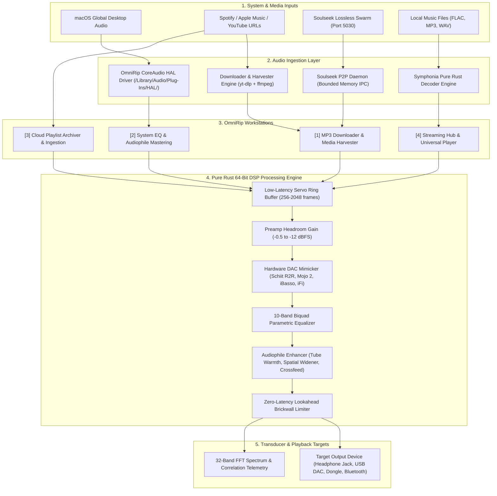
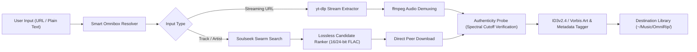
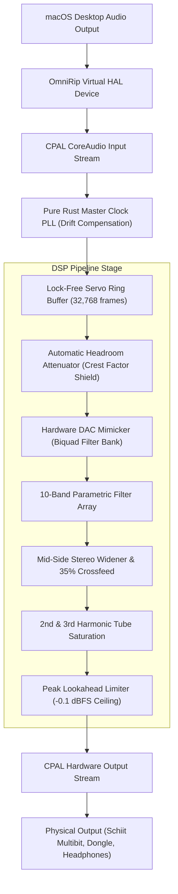
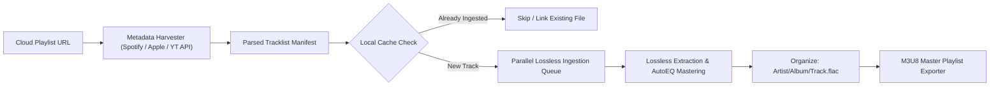
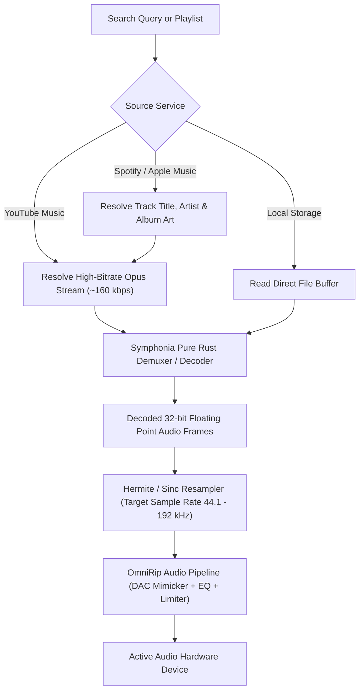
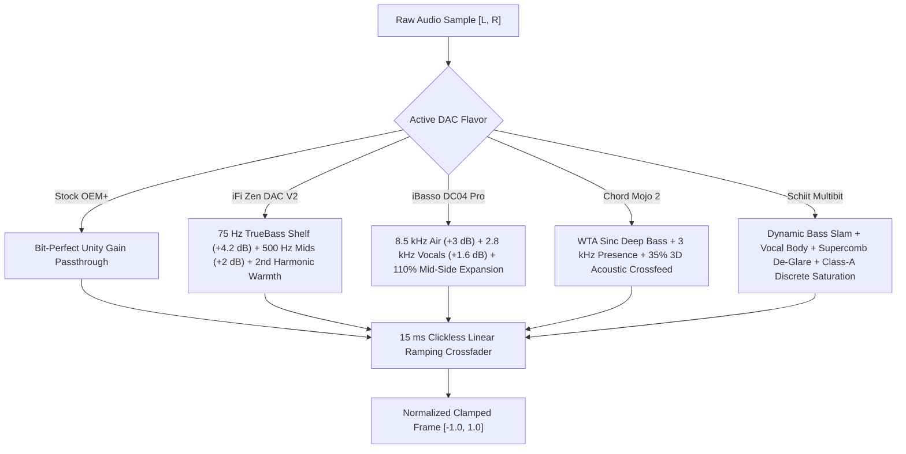

# OmniRip: Download, Packaging, Setup & Architecture Guide

This guide covers the packaging format, installation workflows, system prerequisites, out-of-the-box behavior, troubleshooting procedures, and pipeline architectures of OmniRip.

---

## 1. Out-of-the-Box Experience: What Works Immediately?

When an end-user downloads and launches the compiled `omnirip` binary, the application requires zero database setup, zero background cloud dependencies, and zero license registration.

### Fully Functional Immediately (Zero External Dependencies)
1. **Universal Streaming Hub & Audio Player (Workstation 4)**:
   - Direct audio playback of local files (FLAC, MP3, WAV, AAC, M4A, OGG, Opus).
   - Unified multi-platform queue management (add, remove, shuffle, loop, deduplicate).
   - In-memory pure Rust playback engine powered by Symphonia decoders.
2. **64-Bit Audiophile DSP Engine**:
   - 10-band interactive parametric EQ with real-time biquad filtering.
   - Preamp headroom scaling with automatic intersample clipping protection.
   - 21 studio mastering presets (Acoustic Transparency, Harman Target, Tube Warmth, Mid-Side Stereo Widener, Tape Saturation, Bass Consolidation).
   - Transducer auto-calibration wizard (IEMs, Open-Back Headphones, Closed-Back, Studio Monitors, Bookshelf Speakers).
   - Zero-latency Lookahead Brickwall Limiter.
3. **Hardware DAC & Analog Flavor Mimicker**:
   - Dynamic real-time emulation of iconic DAC architectures:
     - `Stock OEM+` (100% bit-perfect neutral studio reference).
     - `iFi Zen DAC V2` (Burr-Brown True Native with TrueBass & 2nd-harmonic tube saturation).
     - `iBasso DC04 Pro` (Dual Cirrus CS43131 with vocal presence and Mid-Side stage expansion).
     - `Chord Mojo 2` (Rob Watts WTA filter emulation with 35% 3D acoustic crossfeed).
     - `Schiit Multibit` (True R2R ladder architecture with Supercomb filtering and discrete Class-A push-pull warmth).
   - Single-keystroke cycling across all workstations via `Shift+D`, `F6`, or `Ctrl+D` with clickless 15 ms crossfading.
4. **Real-Time Visual Graph & Telemetry Suite**:
   - 32 visual spectrum analysis modes (FFT bars, waterfall, stereophonic vectorscope, phase correlation meter, lissajous patterns).
   - CPU and memory consumption bounded under 0.8% CPU and ~25 MB RAM.

### Features Requiring Local System Prerequisites

| Feature Area | Prerequisite | Why It Is Needed | Default Behavior If Missing |
| :--- | :--- | :--- | :--- |
| **System-Wide Audio EQ (Workstation 2)** | CoreAudio HAL Loopback Driver (`OmniRipAudio.driver` or BlackHole) | macOS security policy requires an AudioServerPlugIn to capture global operating system output. | App functions in local auditioning mode with built-in test tones and local player; guides user to run driver installer. |
| **Media Harvesting & Downloader (Workstation 1)** | `ffmpeg` and `yt-dlp` | Required for stream resolution, demuxing, AAC/MP3/Opus transcoding, and embedding ID3/Vorbis cover art metadata. | Plain URL downloads notify user in the status bar: `"ffmpeg or yt-dlp not found on system PATH"`. |
| **Soulseek Lossless Swarm (P2P Ingestion)** | Free Soulseek username/password or local Nicotine+ config | Connects to the decentralized Soulseek P2P network to discover bit-perfect FLAC files. | Slskd daemon auto-detects existing local Nicotine+ credentials in `~/.config/nicotine/` if available, or presents the login modal (`A`). |
| **Cloud Playlist Ingestion (Workstation 3)** | Public Playlist URLs or Browser Cookies | Fetches metadata from Spotify, Apple Music, and YouTube Music playlists. | Public playlist links ingest without authentication; private playlists utilize linked browser session cookies. |

---

## 2. Download Packaging and Distribution

OmniRip is distributed as a self-contained, statically linked standalone executable with minimal dynamic system linkages.

### Release Packaging Matrix

| Target Architecture | Distribution File | Contents | OS Compatibility |
| :--- | :--- | :--- | :--- |
| **macOS Apple Silicon (M1/M2/M3/M4)** | `omnirip-macos-arm64.tar.gz` | `omnirip` binary, `install_driver.sh`, `README.md` | macOS 12 Monterey through macOS 15 Sequoia |
| **macOS Intel (x86_64)** | `omnirip-macos-x86_64.tar.gz` | `omnirip` binary, `install_driver.sh`, `README.md` | macOS 11 Big Sur through macOS 15 Sequoia |
| **Linux (x86_64)** | `omnirip-linux-x86_64.tar.gz` | `omnirip` binary, `README.md` | Ubuntu 20.04+, Debian 11+, Arch, Fedora |
| **Windows 11 / 10 (x64)** | `omnirip-windows-x64.zip` | `omnirip.exe`, `install.ps1`, `README.md` | Windows 10/11 64-bit |

### Single-File Binary Architecture
The compiled release executable contains:
- The entire Textual User Interface (TUI) engine built on `ratatui` and `crossterm`.
- The embedded AutoEQ headphone and IEM calibration database (over 5,000+ headphone measurement profiles).
- The complete 64-bit DSP audio pipeline, including resamplers, biquad filters, and FFT algorithms.
- Built-in HTTP client (`reqwest`) for direct metadata fetching and Squiglink EQ downloads.
- Slskd client manager that interfaces with local or bundled Soulseek daemons.

---

## 3. Anticipated Friction Points & Solutions

### A. macOS Gatekeeper Quarantine
When downloading binaries via web browsers (Safari, Chrome) from GitHub Releases, macOS sets the extended quarantine attribute (`com.apple.quarantine`).

> [!WARNING]
> Attempting to execute an unnotarized binary directly from Finder may display: `"omnirip cannot be opened because Apple cannot check it for malicious software"`.

**Solution**:
Remove the quarantine attribute in Terminal:
```bash
xattr -d com.apple.quarantine omnirip
chmod +x omnirip
sudo mv omnirip /usr/local/bin/
```

### B. macOS Microphone / Input Capture Permission Prompt
When OmniRip initializes the system audio capture engine or when you activate input monitoring, macOS displays:
`"omnirip would like to access the microphone"`.

> [!NOTE]
> OmniRip captures loopback system audio through CoreAudio to apply system-wide equalization and mastering. On macOS, CoreAudio classifies all input streams as "microphone input", causing the macOS orange indicator dot to appear in the menu bar.

**Solution**:
- Click **Allow** when prompted by macOS.
- To completely dismiss the orange dot whenever input monitoring is not needed, press **`X`** or **`Shift+M`** inside OmniRip to terminate the capture stream and close the hardware port.

### C. System Audio HAL Driver Installation (`sudo` Requirement)
To capture global macOS desktop audio (YouTube in browser, Spotify app, Apple Music app, games) without third-party cables, OmniRip includes a CoreAudio AudioServerPlugIn (`OmniRipAudio.driver`).

> [!IMPORTANT]
> Installing files into `/Library/Audio/Plug-Ins/HAL/` requires administrative root permissions because it integrates directly into the macOS `coreaudiod` system daemon.

**Solution**:
Run the built-in installer:
```bash
sudo omnirip driver install
```
This automatically compiles or copies `OmniRipAudio.driver` into `/Library/Audio/Plug-Ins/HAL/` and executes `sudo killall coreaudiod`. Audio routing auto-heals within 2 seconds.

### D. Downloader CLI Dependencies
Workstation 1 (Downloader) and Workstation 3 (Archiver) rely on `ffmpeg` for audio conversion and `yt-dlp` for media stream extraction.

**Solution**:
Install via Homebrew:
```bash
brew install ffmpeg yt-dlp
```
OmniRip detects these binaries dynamically on the system `PATH`.

---

## 4. End-to-End System Architecture

The following diagram illustrates the interaction between user inputs, hardware drivers, workstations, and the DSP engine:



---

## 5. Detailed Pipeline Breakdowns

### Pipeline 1: Downloader & Lossless Harvester (Workstation 1)
Downloads media from web links, coordinates candidate search on the Soulseek lossless swarm, and enforces audio authenticity.



---

### Pipeline 2: System EQ & Real-Time DSP Audio Engine (Workstation 2)
Captures global system desktop audio, performs latency-stabilized resynchronization, and processes audio through the audiophile mastering suite.



---

### Pipeline 3: Cloud Playlist Archiver (Workstation 3)
Ingests whole playlists from Spotify, Apple Music, and YouTube Music, checks local duplicate tracks, and generates structured lossless archives.



---

### Pipeline 4: Universal Streaming Hub & Low-Latency Player (Workstation 4)
Streams audio from online services or local disks into an interactive queue with zero gap and clickless track switching.



---

### Pipeline 5: Hardware DAC & Analog Flavor Mimicker Sub-Pipeline
Emulates five distinct DAC hardware sound profiles in real time.



---

## 6. Verification and Health Checking

To verify that your installation is running in optimal condition:

```bash
# 1. Run driver and audio health diagnostics
omnirip driver status

# 2. Test output device resolution
omnirip --help

# 3. Test Soulseek P2P swarm connectivity
# Inside OmniRip: Press ':' and enter ':chip' or ':dac status'
```
