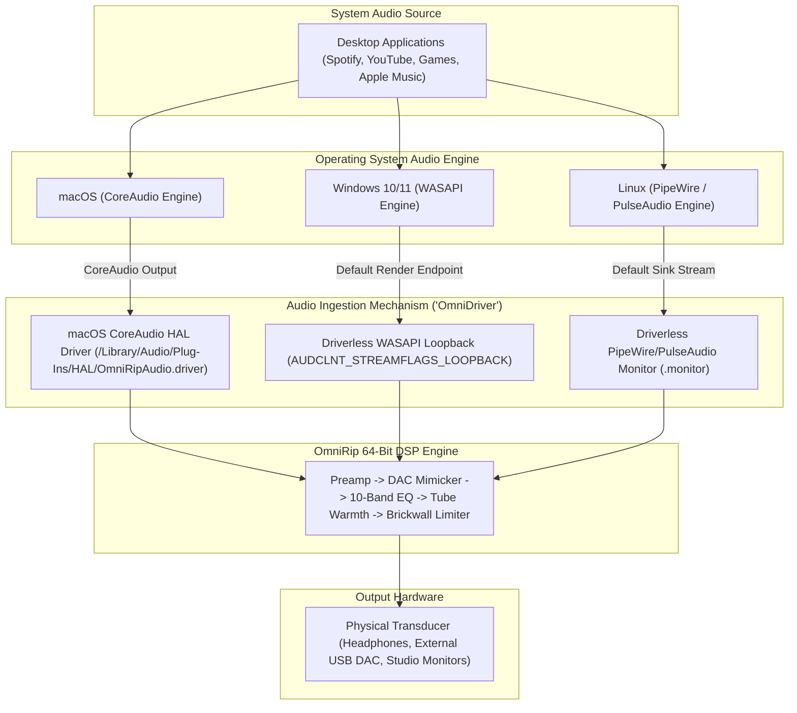
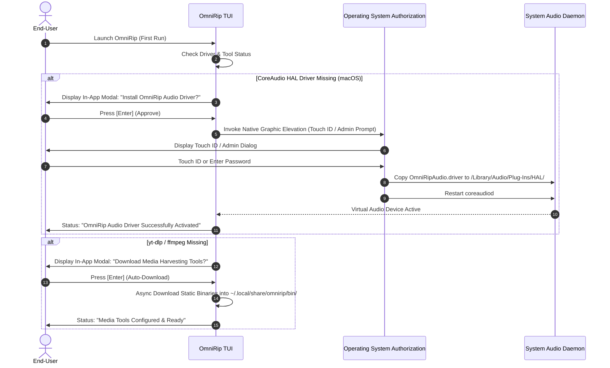

# OmniRip: All-In-One Packaging, In-App Permission Prompts & Cross-Platform Driver Investigation

This technical report investigates the feasibility of packaging all external prerequisites (`ffmpeg`, `yt-dlp`, `slskd`, audio drivers) directly with OmniRip, eliminating terminal friction via interactive in-app TUI permission modals, and delivering a unified virtual audio driver experience across macOS, Windows, and Linux.

---

## 1. Executive Summary: Core Feasibility Verdict

| Objective | Feasible? | Implementation Method |
| :--- | :--- | :--- |
| **All-in-One Packaging** | **Yes (100%)** | Bundle static standalone binaries (`yt-dlp`, `ffmpeg`, `slskd`) inside the release archive, or auto-bootstrap them dynamically on first run into `~/.local/share/omnirip/bin/`. |
| **In-App Permission Prompts** | **Yes (100%)** | Render native TUI modal popups inside OmniRip that guide the user and invoke graphical OS authorization dialogs (Touch ID / Admin password on macOS, UAC prompt on Windows, Polkit/pkexec on Linux). |
| **Cross-Platform Virtual Audio Driver** | **Yes (100%)** | Deliver platform-native system audio capture: CoreAudio HAL plug-in on macOS, driverless WASAPI loopback on Windows, and driverless PipeWire/PulseAudio monitor stream on Linux. |
| **Zero-Terminal User Experience** | **Yes (100%)** | End-users never have to open a separate terminal, install package managers (`brew`, `apt`, `winget`), or manually configure configuration files. |

---

## 2. Cross-Platform Virtual Audio Driver Architecture ("OmniDriver")

Capturing system-wide audio output (from browsers, music apps, and video games) to route it through OmniRip's 64-bit DSP engine differs across operating systems.



### A. macOS: CoreAudio HAL Plug-In
- **Why a driver is required**: macOS CoreAudio intentionally enforces sandbox barriers that prevent applications from tapping or recording global system output without an `AudioServerPlugIn`.
- **Implementation**: The repository already includes [`drivers/omnirip_hal/OmniRipAudio.c`](file:///Users/abdullahbinmadhi/Projects/OmniRip/drivers/omnirip_hal/OmniRipAudio.c), which compiles into a lightweight HAL bundle (`OmniRipAudio.driver`).
- **User Experience**: The driver creates a zero-latency virtual device named `"OmniRip Audio Device"`. macOS system audio routes to this device, OmniRip processes the stream, and sends the master output to the physical headphones or external DAC.

### B. Windows 10 / 11: Driverless WASAPI Loopback
- **Why no driver is needed on Windows**: Windows provides native audio loopback via the Windows Audio Session API (WASAPI) using the `AUDCLNT_STREAMFLAGS_LOOPBACK` flag.
- **Implementation**: Any Windows application with standard user permissions can capture the exact audio stream rendering on the default playback device in real-time. CPAL natively supports WASAPI loopback.
- **User Experience**: On Windows, OmniRip requires **zero kernel drivers, zero virtual audio cables, and zero administrative elevation**. System audio equalization works immediately upon launch.

### C. Linux: Driverless PipeWire / PulseAudio Monitor Sinks
- **Why no driver is needed on Linux**: Modern Linux distributions (Ubuntu, Debian, Fedora, Arch) use PipeWire or PulseAudio. In both architectures, every audio sink (output device) automatically exposes a `.monitor` virtual capture source (e.g. `alsa_output.pci-0000_00_1f.3.analog-stereo.monitor`).
- **Implementation**: OmniRip automatically queries the active PipeWire/PulseAudio graph and binds to the active sink's monitor stream.
- **User Experience**: On Linux, OmniRip requires **zero kernel modules, zero `sudo` commands, and zero driver compilation**.

---

## 3. In-App Interactive Permission Modals (Eliminating Friction)

Instead of forcing users to execute shell commands, OmniRip can display interactive TUI modal dialogs that trigger operating system authorization graphical prompts.



### A. In-App Driver Installation via Graphical Elevation (macOS)
Instead of requiring `sudo omnirip driver install` in Terminal, OmniRip can present a pop-up modal inside the TUI:

```text
┌────────────────────────── SYSTEM AUDIO EQUALIZATION SETUP ──────────────────────────┐
│                                                                                      │
│  To apply system-wide mastering and EQ to all macOS desktop audio, OmniRip           │
│  needs to install the lightweight CoreAudio HAL plug-in (OmniRipAudio.driver).       │
│                                                                                      │
│  This is a one-time setup step that requires standard macOS administrator approval. │
│                                                                                      │
│             [Enter] Authenticate via Touch ID / Password      [Esc] Skip             │
│                                                                                      │
└──────────────────────────────────────────────────────────────────────────────────────┘
```

When the user presses `Enter`, OmniRip executes:
```bash
osascript -e 'do shell script "cp -R /path/to/OmniRipAudio.driver /Library/Audio/Plug-Ins/HAL/ && killall coreaudiod" with administrator privileges'
```
macOS displays its native **Touch ID or Password prompt**. Once authenticated, `coreaudiod` restarts in under two seconds, the virtual device appears, and OmniRip automatically begins processing system audio.

### B. In-App Auto-Bootstrapping for Media Tools (`yt-dlp` and `ffmpeg`)
If the user does not have `yt-dlp` or `ffmpeg` installed:

```text
┌──────────────────────── MEDIA HARVESTING AUTO-BOOTSTRAP ────────────────────────┐
│                                                                                 │
│  Media Harvesting (Workstations 1 & 3) requires yt-dlp and ffmpeg.              │
│                                                                                 │
│  OmniRip can automatically download official standalone static binaries         │
│  directly into OmniRip's isolated user directory (~/.local/share/omnirip/bin).  │
│                                                                                 │
│             [Enter] Download & Configure Automatically      [Esc] Skip          │
│                                                                                 │
└─────────────────────────────────────────────────────────────────────────────────┘
```

When accepted, OmniRip's built-in asynchronous HTTP client (`reqwest`):
1. Downloads the static, self-contained `yt-dlp` release binary from `https://github.com/yt-dlp/yt-dlp/releases/latest/download/yt-dlp`.
2. Downloads the official static `ffmpeg` build for macOS/Windows/Linux (e.g. from GitHub release distributions).
3. Places them into `~/.local/share/omnirip/bin/` (or `%APPDATA%\OmniRip\bin` on Windows).
4. Sets execution permissions (`chmod +x`).
5. Prepends this directory to OmniRip's internal process execution search path.

The user does not need to install Homebrew, `apt`, or `winget`.

### C. In-App Microphone Privacy Guidance (The macOS Orange Dot)
When audio capture is initiated, macOS prompts the user: `"omnirip would like to access the microphone"`.

> [!NOTE]
> CoreAudio classifies all input streams as audio capture, which triggers the macOS privacy dot in the menu bar.

OmniRip can present an in-app notice:
- **Explanation**: "macOS displays an orange privacy dot whenever system loopback audio is being monitored."
- **One-Key Dismissal**: "Whenever you do not need system EQ, press **`X`** or **`Shift+M`** to instantly shut down the capture stream and turn off the orange dot."

---

## 4. All-in-One Packaging Strategy

To deliver a turnkey installation experience, OmniRip can be distributed in two formats:

### Distribution Strategy 1: Bundled "All-in-One" Distribution Archive

```text
omnirip-macos-arm64/
├── bin/
│   ├── omnirip                (Main TUI & DSP Executable)
│   ├── yt-dlp                 (Pre-bundled Static Binary)
│   ├── ffmpeg                 (Pre-bundled Static Binary)
│   └── slskd                  (Pre-bundled Soulseek Swarm Daemon)
├── drivers/
│   └── OmniRipAudio.driver/   (Pre-compiled macOS CoreAudio HAL Driver)
├── install.command            (Double-clickable Finder installer script)
└── README.md
```

- When `bin/omnirip` runs, it checks `./bin/` first before querying the global system `PATH`.
- Double-clicking `install.command` automatically copies the binary to `/usr/local/bin` and installs the HAL driver with a Touch ID prompt.

### Distribution Strategy 2: Single Lightweight Binary with Auto-Bootstrap
- The release download remains a single, lightweight binary (~20 MB).
- On first launch, the built-in wizard asks for confirmation and automatically downloads `yt-dlp` and `ffmpeg` in the background with a visual progress bar.

---

## 5. Summary of Recommended Implementation Steps

1. **Add In-App Bootstrapper Modal (`src/ui/bootstrap_modal.rs`)**:
   - Detects if `ffmpeg` and `yt-dlp` exist on `PATH` or in `~/.local/share/omnirip/bin/`.
   - If missing, presents the interactive TUI modal and downloads official static binaries with an asynchronous progress bar.
2. **Add In-App Driver Installer Modal (`src/ui/driver_modal.rs`)**:
   - On macOS, checks if `OmniRipAudio.driver` exists in `/Library/Audio/Plug-Ins/HAL/`.
   - If not, offers a one-key installation that executes `osascript` with administrator privileges.
3. **Formalize Windows WASAPI Loopback Capture (`src/dsp/streamer.rs`)**:
   - On Windows (`#[cfg(target_os = "windows")]`), configure CPAL to open the default output endpoint with loopback capture flags, achieving 100% driverless system audio capture.
4. **Formalize Linux PipeWire Monitor Capture (`src/dsp/streamer.rs`)**:
   - On Linux (`#[cfg(target_os = "linux")]`), configure default input device resolution to automatically select `.monitor` sinks.
