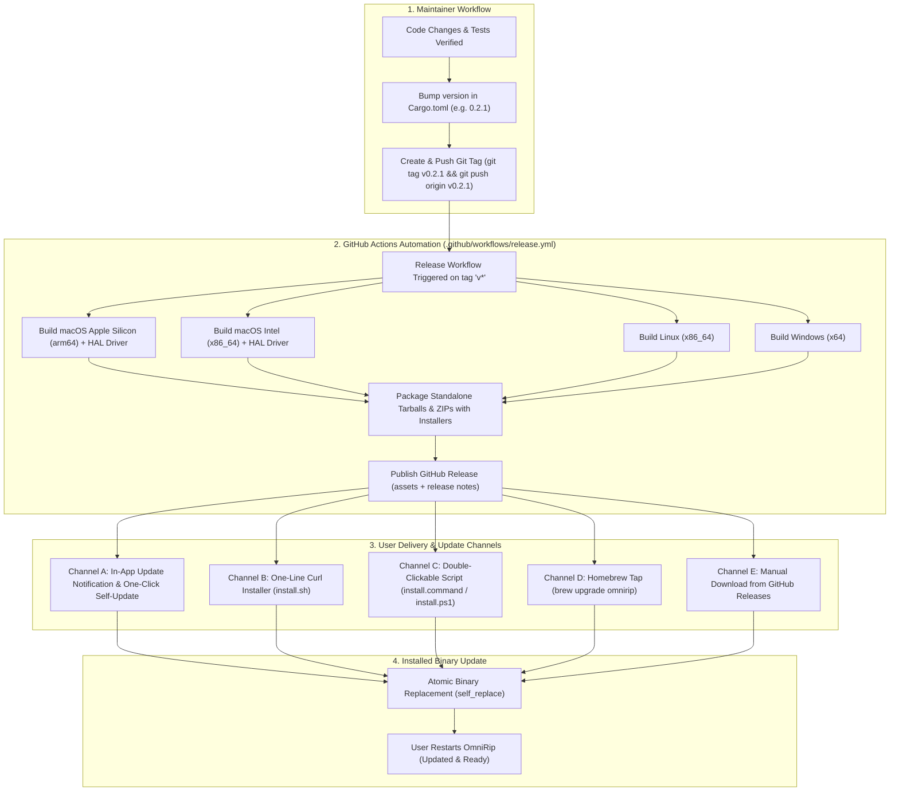

# OmniRip: Release and Update Lifecycle Guide

This guide explains how updates are published by the maintainer and how end-users discover, receive, and install them across macOS, Windows, and Linux.

---

## 1. End-to-End Release & Update Pipeline



---

## 2. How the Maintainer Publishes an Update

Releasing an update is completely automated through GitHub Actions.

### Step 1: Bump Version in `Cargo.toml`
Update the version string in `Cargo.toml`:
```toml
[package]
name = "omnirip"
version = "0.2.1"
```

### Step 2: Commit and Create a Tag
```bash
git commit -am "chore(release): bump version to v0.2.1"
git push origin main

# Create annotated git tag
git tag v0.2.1
git push origin v0.2.1
```

### Step 3: Automated Multi-Platform Compilation
Pushing the `v0.2.1` tag automatically triggers [`.github/workflows/release.yml`](file:///Users/abdullahbinmadhi/Projects/OmniRip/.github/workflows/release.yml). The GitHub Actions runners:
1. Compile optimized standalone release binaries for:
   - `aarch64-apple-darwin` (macOS Apple Silicon M1/M2/M3/M4)
   - `x86_64-apple-darwin` (macOS Intel)
   - `x86_64-unknown-linux-gnu` (Linux)
   - `x86_64-pc-windows-msvc` (Windows 10/11)
2. Compile the CoreAudio HAL virtual driver bundle (`OmniRipAudio.driver`) on macOS.
3. Bundle `scripts/install.sh`, `scripts/install.command`, `scripts/install.ps1`, and `README.md`.
4. Publish a release to `https://github.com/abdullah-binmadhi/OmniRip/releases/tag/v0.2.1` with release notes generated from your commits.

---

## 3. How Users Receive and Install the Update

Users have multiple frictionless channels to receive updates:

### Channel A: In-App Update Notification & One-Click Upgrade (Recommended)
OmniRip queries the GitHub Releases API (`https://api.github.com/repos/abdullah-binmadhi/OmniRip/releases/latest`) periodically or on launch.

When a newer version exists (e.g. remote `v0.2.1` > local `v0.2.0`):
1. **Status Notification**: OmniRip displays a notification in the status bar:
   `"Update Available: v0.2.1 (Current: v0.2.0). Type :update to upgrade."`
2. **Setup Wizard Notification**: The Setup Wizard (`F12` or `:setup`) highlights an update button:
   `[U] Upgrade to OmniRip v0.2.1`
3. **Execution**: OmniRip downloads the release tarball matching the user's OS and CPU architecture, extracts the new binary, and performs an **atomic binary replacement**.
4. **Restart**: OmniRip notifies the user: `"OmniRip updated to v0.2.1. Restart to apply."`

---

### Channel B: One-Line Curl Installer (`install.sh`)
Users who installed via the one-line terminal script can simply run the script again:
```bash
curl -fsSL https://raw.githubusercontent.com/abdullah-binmadhi/OmniRip/main/scripts/install.sh | bash
```
The script:
1. Queries the GitHub API for the latest release tag.
2. Downloads the matching archive for their machine.
3. Extracts and replaces the existing binary in `/usr/local/bin/omnirip` (or `~/.local/bin/omnirip`).
4. Strips the macOS `com.apple.quarantine` attribute automatically.

---

### Channel C: Double-Clickable Desktop Script (`install.command` / `install.ps1`)
Users who do not use the command line can update by double-clicking:
- **macOS**: Double-click `install.command` in the OmniRip folder. Terminal opens, downloads the latest binary, and updates the installation in 5 seconds.
- **Windows**: Right-click `install.ps1` and select **Run with PowerShell**.

---

### Channel D: Homebrew Tap (macOS & Linux)
If OmniRip is distributed via a Homebrew tap (e.g., `abdullah-binmadhi/homebrew-tap`):
```bash
brew update
brew upgrade omnirip
```
Homebrew automatically handles downloading the binary, verifying checksums, and linking into `/opt/homebrew/bin`.

---

### Channel E: Manual Download
Users can download the archive directly from the GitHub Releases page, extract it, and overwrite the existing binary.

---

## 4. Technical Details: Atomic Binary Replacement

Updating an executable while it is currently executing requires handling OS-level file locking differences:

### Unix (macOS & Linux)
- On Unix, the kernel permits an executing binary file to be unlinked (`unlink`) or renamed (`rename`), even while a process is running from that inode.
- OmniRip downloads the new binary to a temporary file (`omnirip.new`), applies `chmod +x`, and executes `std::fs::rename("omnirip.new", current_exe_path)`.
- The running process continues unaffected until restart, at which point the new binary launches seamlessly.

### Windows
- On Windows, the operating system locks running `.exe` files, preventing direct overwrites.
- To overcome this, OmniRip renames the currently running executable to `omnirip.old`, copies the new binary to `omnirip.exe`, and schedules `omnirip.old` for deletion upon reboot or process termination.

---

## 5. Summary Matrix of Update Channels

| Channel | User Action Required | Technical Mechanism | Administrative Rights Needed? |
| :--- | :--- | :--- | :--- |
| **In-App Upgrade** | Type `:update` or press `[U]` in `:setup` wizard | In-app HTTP download via `reqwest` + atomic file swap | No (installs to user directory) |
| **One-Line Curl** | Run `curl ... \| bash` | Shell script fetches latest GitHub release archive | Only if installing to `/usr/local/bin` |
| **Finder Script** | Double-click `install.command` | Runs `scripts/install.sh` in Terminal window | Only if installing to `/usr/local/bin` |
| **Homebrew** | Run `brew upgrade omnirip` | Homebrew package manager formula update | No |
| **Manual** | Download from GitHub Releases | Manual un-tar and file copy | No |
